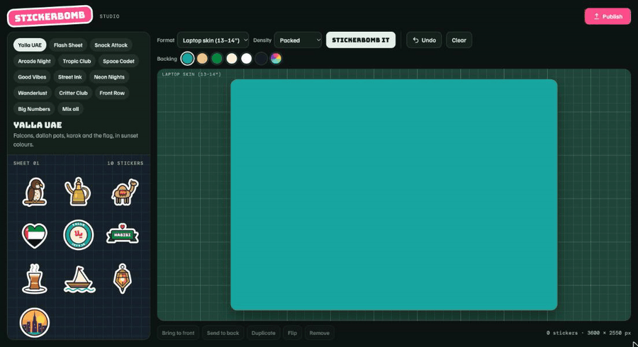

# Stickerbomb Studio

Build your own sticker-bomb montage from themed sticker collections, then export it as a phone wallpaper, desktop wallpaper, laptop skin or phone case print.

**[Make a montage → stickerbomb.onrender.com](https://stickerbomb.onrender.com)**

## Why I built it

Sticker-bombed laptops and phone cases are a big part of how people show their personality, but making a good montage by hand is fiddly. I wanted a playful creative tool where anyone can build one in a minute and export it at print quality.

- **Audience:** people who personalise their phones and laptops, and small print-on-demand sellers.
- **Approach:** themed collections (including a UAE pack), one-tap "Stickerbomb it" layouts, then drag, rotate and resize, and export at real wallpaper and print sizes.
- **What I'd measure:** montages published, which collections get used most, and which export formats people choose. That would show which themes to add next.
- **What I learned:** all the sticker art is drawn in code, which keeps it original and free of third-party brands, and makes adding a new collection quick.

## What's in it

- 13 original sticker collections (130 stickers): Yalla UAE, Flash Sheet (tattoo), Snack Attack (food), Arcade Night, Tropic Club, Space Cadet, Good Vibes, Street Ink, Neon Nights, Wanderlust (travel), Critter Club (animals), Front Row (fashion) and Big Numbers (1–10), plus "Mix all". Tab order is set by `ORDER` in `index.html`.
- **Stickerbomb it** fills the canvas automatically (Loose, Packed or Wall-to-wall).
- Drag to move, corner handle to rotate and resize, pinch on touch screens, undo.
- **Publish** renders a full-resolution PNG:

| Format | Size (px) | Print size |
| --- | --- | --- |
| Phone wallpaper | 1290 × 2796 | Screen only |
| Desktop wallpaper | 2560 × 1440 | Screen only |
| Laptop skin (13–14") | 3600 × 2550 | 30.5 × 21.6 cm at 300 dpi |
| Phone case print | 1500 × 3000 | 12.7 × 25.4 cm at 300 dpi |
| Square post | 2400 × 2400 | 20.3 × 20.3 cm at 300 dpi |

All sticker art is drawn in code in `index.html` and is original. It contains no third-party characters, logos or brand marks.

## Run locally

Open `index.html` in a browser. There is no build step.

## Deploy on Render

This repo includes a `render.yaml` blueprint for a free static site.

1. In the Render dashboard choose **New → Blueprint** and pick this repository, or choose **New → Static Site** with an empty build command and publish directory `.`.
2. Render deploys automatically on every push to `main`.

## Adding a sticker collection

Collections live in the `THEMES` array in `index.html`. Each sticker is a name plus a drawing function in a 200 × 200 box; the die-cut white border and shadow are added automatically.
